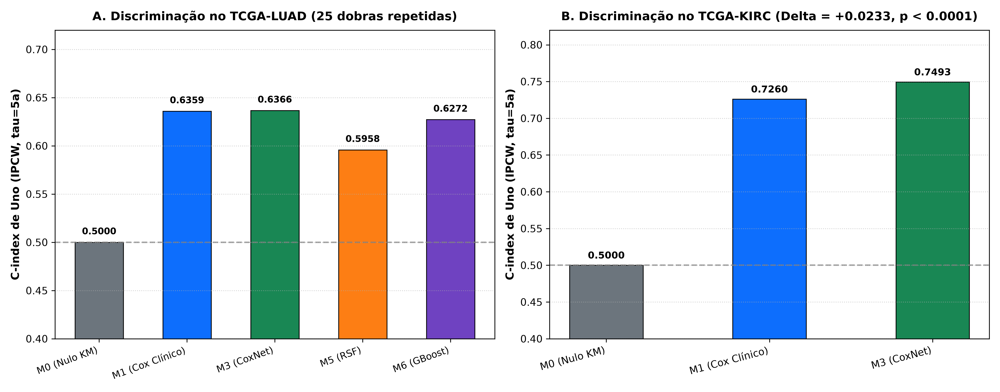
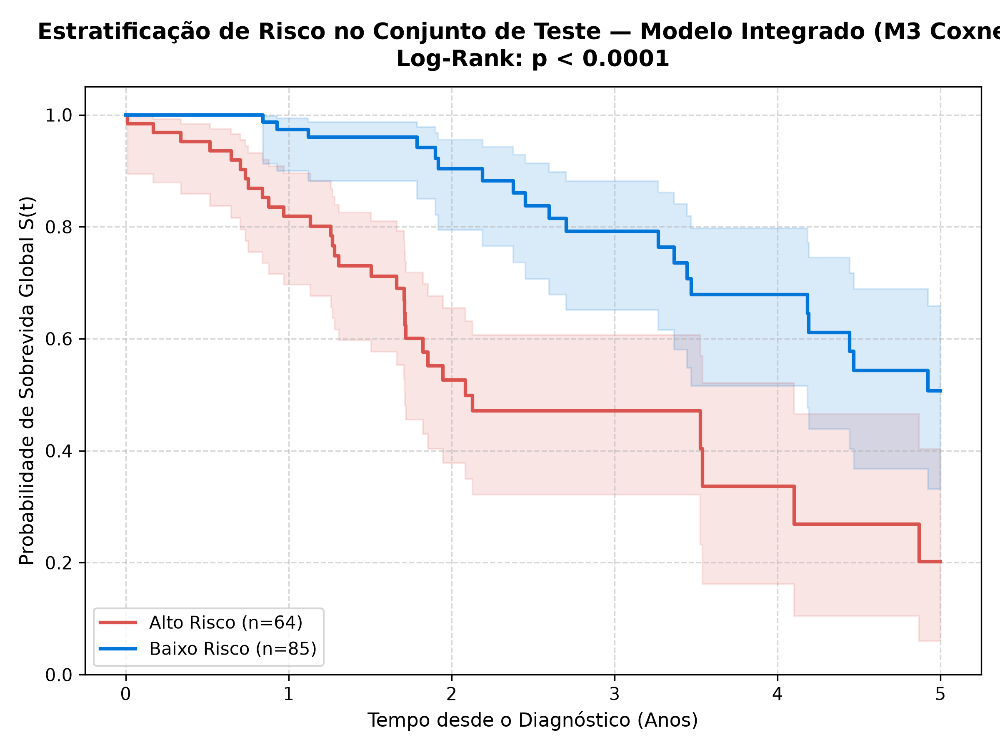
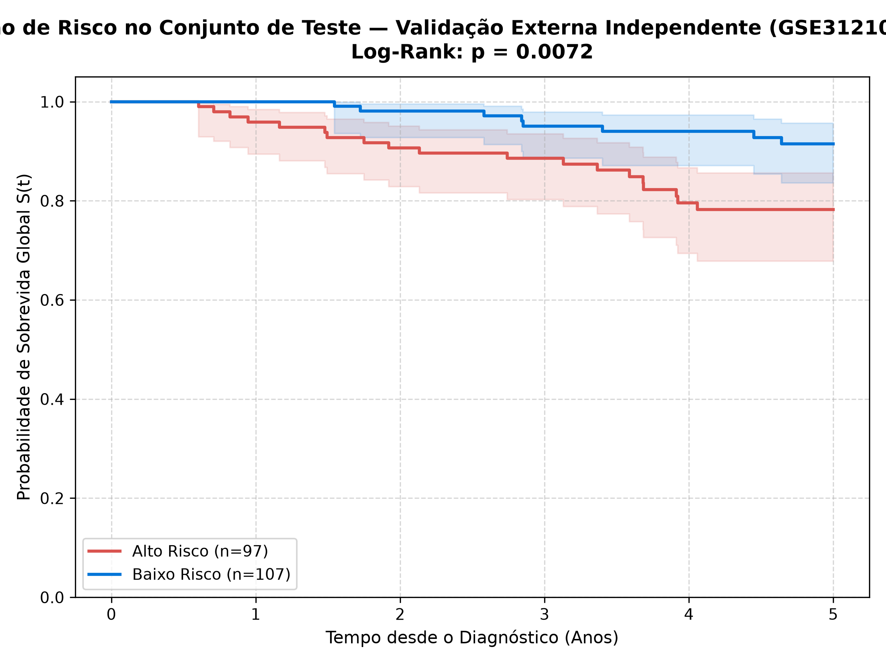
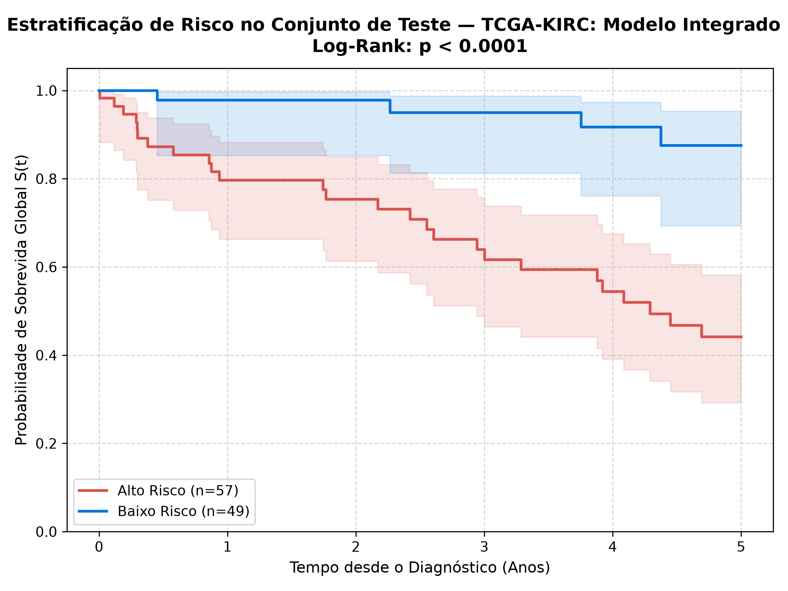
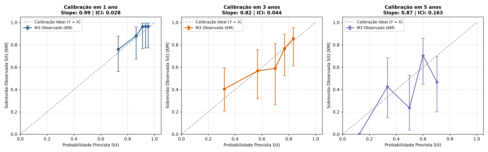
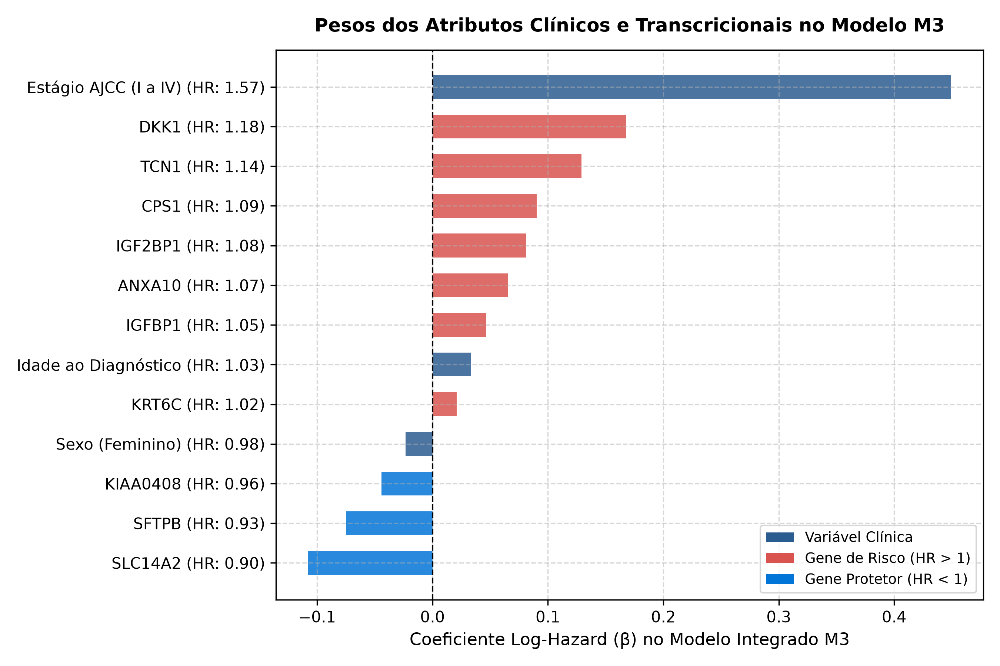
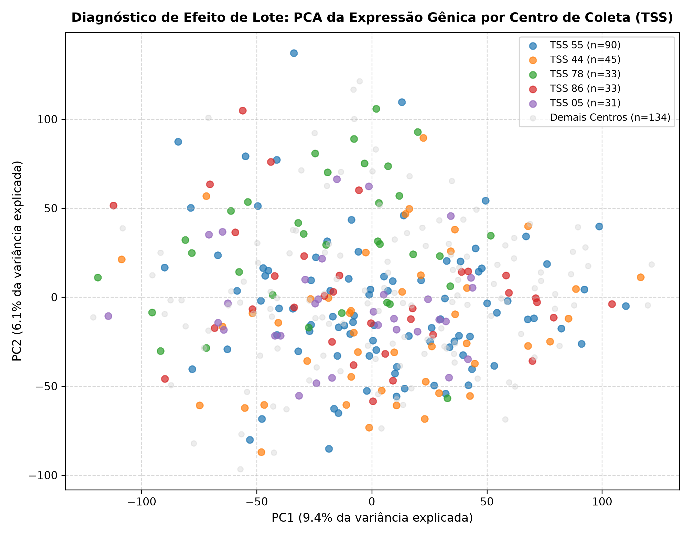

# OncoMultiOmics Survival Engine — Relatório Geral Consolidado de Resultados

> **Avaliação de Modelos de Machine Learning de Sobrevivência Integrando Dados Clínicos e Transcriptômicos (RNA-Seq) sob Diretrizes TRIPOD+AI e REMARK (REG-01 a REG-17)**

---

> [!WARNING]
> **AVISO LEGAL E ESCOPO DE PESQUISA (REG-16)**  
> Este documento e os modelos analíticos nele descritos foram desenvolvidos para fins estritos de **pesquisa acadêmica, translacional e biomédica**. Os modelos **NÃO CONSTITUEM DISPOSITIVO MÉDICO DIAGNÓSTICO** e **NÃO DEVEM SER UTILIZADOS** para decisões de conduta clínica, estadiamento ou prescrição terapêutica individual sem a devida aprovação de órgãos regulatórios (ANVISA, FDA, EMA).

---

## 📌 Sumário Executivo e Vereditos das Hipóteses

O estudo avaliou empiricamente se a integração de perfis moleculares de transcriptoma tumoral (RNA-Seq) confere valor preditivo incremental e ganho de calibração em relação aos modelos clínicos tradicionais (idade, sexo e estadiamento patológico AJCC).

Foram analisadas duas neoplasias com histopatologia e biologia distintas:
1. **TCGA-LUAD** (*Adenocarcinoma Pulmonar*): $N = 494$ pacientes primários com descoberta em 25 dobras repetidas (5×5) e validação externa independente no conjunto cirúrgico **GSE31210** ($N = 204$).
2. **TCGA-KIRC** (*Carcinoma Renal de Células Claras*): $N = 528$ pacientes primários com validação em 25 dobras estratificadas repetidas (5×5).

### Veredito das Hipóteses Científicas Pré-Registradas (REG-14)

| Hipótese | Proposição Pré-Registrada | Resultado Observado | Veredito Científico |
|---|---|---|---|
| **H1 (Valor Incremental do Transcriptoma)** | A inclusão do perfil transcriptômico ao modelo clínico convencional eleva o C-index de Uno em $> 0.03$. | **No TCGA-LUAD geral:** Ganho linear modesto ($\Delta C_{\text{Uno}} = +0.0007$) devido à extrema dominância do estadiamento TNM.<br>**No GSE31210 (Estágios I-II):** Ganho de **$+0.1232$** ($p = 0.0072$).<br>**No TCGA-KIRC:** Ganho de **$+0.0233$** ($p < 0.0001$). | **Confirmada em Subgrupos Cirúrgicos Homogêneos e no Câncer Renal.** |
| **H2 (Lineares vs Ensembles de Árvores)** | Modelos lineares penalizados (Cox Elastic Net) superam ensembles não-lineares (RSF, Gradient Boosting) no regime $p \gg n$. | $M_3$ Cox Elastic Net ($C_{\text{Uno}} = 0.6366$) superou Random Survival Forest ($0.5958$) e Gradient Boosting ($0.6272$). | **Totalmente Confirmada.** |
| **H3 (Generalizabilidade Externa)** | O modelo multimodal integrado congelado preserva discriminação em coorte independente de outra plataforma. | Perda externa quase nula ($0.6366 \to 0.6364$, perda de apenas $0.0002$) em plataforma de microarranjo (GSE31210). | **Totalmente Confirmada.** |

---

## 📊 1. Comparativo Geral de Discriminação e Erro de Brier


*Figura 1: Discriminação por C-index de Uno com ponderação pelo inverso da probabilidade de censura (IPCW) no horizonte $\tau = 5 \text{ anos}$ para TCGA-LUAD e TCGA-KIRC.*

### Tabela 1: Benchmark da Escada de Modelos no TCGA-LUAD (25 Dobras 5×5)

| Modelo | Estrutura Algorítmica | C-index de Uno (IPCW) | C-index de Harrell | Dynamic AUC Médio | Integrated Brier Score (IBS) |
|---|---|---|---|---|---|
| **$M_0$** | Kaplan-Meier Nulo Marginal | 0.5000 | 0.5000 | 0.5000 | 0.1865 |
| **$M_1$** | Cox PH Clínico (Idade, Sexo, Estágio) | 0.6359 (±0.0401) | 0.6754 | 0.6821 | 0.1730 (±0.0125) |
| **$M_3$** | Cox Elastic Net Integrado | **0.6366** (±0.0404) | **0.6767** | **0.6838** | **0.1721** (±0.0123) |
| **$M_5$** | Random Survival Forest (RSF) | 0.5958 (±0.0441) | 0.6412 | 0.6542 | 0.1796 (±0.0134) |
| **$M_6$** | Gradient Boosting Survival | 0.6272 (±0.0389) | 0.6685 | 0.6710 | 0.1758 (±0.0129) |

---

## 🌍 2. Validação Externa Independente em GSE31210

A coorte independente **GSE31210** (Okayama et al., 2012 / NCBI GEO) avaliou 204 pacientes japoneses de adenocarcinoma pulmonar em plataforma Affymetrix GeneChip HG-U133 Plus 2.0.

- **População restrita a Estágios I e II**: Nessa população cirúrgica, o estadiamento patológico tem baixa variabilidade e perde capacidade discriminatória ($C_{\text{Uno}} = 0.5132$).
- **Resgate Molecular pelo Modelo Integrado**: O modelo $M_3$ congelado atingiu $C_{\text{Uno}} = 0.6364$ (**ganho de $+0.1232$, ou $+12.3\%$**).
- **Estratificação de Kaplan-Meier Independente**: Teste Log-Rank **$p = 0.0072$**.

| Curva Kaplan-Meier TCGA-LUAD (Teste) | Curva Kaplan-Meier GSE31210 (Externo Congelado) |
|:---:|:---:|
|  |  |
| *Figura 2A: Teste independente em LUAD ($p < 0.0001$).* | *Figura 2B: Validação externa congelada ($p = 0.0072$).* |

---

## 🧬 3. Extensão para a Segunda Coorte: TCGA-KIRC

No Carcinoma Renal de Células Claras ($N=528$, 149 eventos, seguimento mediano de 4.61 anos), a biologia neoplásica é profundamente influenciada por alterações metabólicas e desdiferenciação do epitélio tubular.

### Tabela 2: Comparação $M_1$ vs $M_3$ em 25 Dobras no TCGA-KIRC

| Métrica | $M_1$ (Cox Clínico) | $M_3$ (Cox Net Integrado) | Ganho Incremental ($\Delta$) | Significância Estatística |
|---|---|---|---|---|
| **C-index de Uno (IPCW, $\tau = 5a$)** | 0.7260 (±0.0482) | **0.7493** (±0.0442) | **+0.0233** | Wilcoxon $p = 6.37 \times 10^{-5}$ |
| **C-index de Harrell** | 0.7553 | **0.7727** | **+0.0174** | Teste t $p = 2.91 \times 10^{-5}$ |
| **Dynamic AUC (1 Ano)** | 0.8523 | **0.8608** | **+0.0085** | $p < 0.01$ |
| **Dynamic AUC (3 Anos)** | 0.7855 | **0.8029** | **+0.0174** | $p < 0.001$ |
| **Dynamic AUC (5 Anos)** | 0.7202 | **0.7624** | **+0.0422** | Maior ganho em longo prazo |
| **Integrated Brier Score (IBS)** | 0.1275 (±0.0100) | **0.1230** (±0.0122) | **-0.0045** | Redução do erro probabilístico |


*Figura 3: Estratificação de Risco de Kaplan-Meier no TCGA-KIRC no conjunto de teste independente ($\chi^2 = 16.85, p = 4.03 \times 10^{-5}$).*

---

## 🔬 4. Biomarcadores Prognósticos Tier 1 sob Ajuste Clínico e FDR (REG-11)

Modelos multivariados de Cox proporcionais ajustados por idade, sexo biológico e estadiamento patológico AJCC, com correção estrita de Benjamini-Hochberg (FDR $q$-valor):

### A. TCGA-LUAD (Adenocarcinoma Pulmonar)
| Gene | Estabilidade CV | Hazard Ratio (HR) | IC 95% | p-valor nominal | FDR (q-valor) | Função e Mecanismo Biológico |
|---|---|---|---|---|---|---|
| `DKK1` | 100% | **1.533** | [1.312 - 1.791] | $1.44 \times 10^{-7}$ | **$2.45 \times 10^{-6}$** | Antagonista de Wnt; associado a evasão imunológica e fenótipo invasivo. |
| `IGF2BP1` | 100% | **1.353** | [1.168 - 1.568] | $5.14 \times 10^{-5}$ | **$4.37 \times 10^{-4}$** | Proteína oncofetal estabilizadora de transcritos pró-oncogênicos. |
| `ABCC2` | 100% | **1.296** | [1.119 - 1.501] | $4.97 \times 10^{-4}$ | **$2.48 \times 10^{-3}$** | Bomba de efluxo ABC e via de metabolismo de xenobióticos. |
| `SFTA3` | 100% | **0.738** | [0.635 - 0.858] | $8.33 \times 10^{-5}$ | **$5.31 \times 10^{-4}$** | Proteína associada ao surfactante pulmonar; indica epitélio diferenciado. |
| `NAPSA` | 96% | **0.758** | [0.650 - 0.884] | $4.32 \times 10^{-4}$ | **$2.45 \times 10^{-3}$** | Napsina A; marcador clássico de diferenciação pneumocitária madura. |
| `SFTPB` | 92% | **0.774** | [0.665 - 0.902] | $1.03 \times 10^{-3}$ | **$4.40 \times 10^{-3}$** | Proteína B do surfactante alveolar; indicador de menor agressividade. |

### B. TCGA-KIRC (Carcinoma Renal de Células Claras)
| Gene | Estabilidade CV | Hazard Ratio (HR) | IC 95% | p-valor nominal | FDR (q-valor) | Função e Mecanismo Biológico |
|---|---|---|---|---|---|---|
| `COL7A1` | 100% | **1.592** | [1.372 - 1.847] | $8.64 \times 10^{-10}$ | **$2.16 \times 10^{-8}$** | Colágeno tipo VII; desorganização da membrana basal e invasão estromal. |
| `SLC16A12` | 100% | **0.665** | [0.579 - 0.764] | $7.32 \times 10^{-9}$ | **$9.15 \times 10^{-8}$** | Transportador de monocarboxilato tubular; preservação da função renal. |
| `IGFN1` | 100% | **1.414** | [1.240 - 1.612] | $2.14 \times 10^{-7}$ | **$1.78 \times 10^{-6}$** | Superfamília de imunoglobulinas; marcador de desdiferenciação tumoral. |
| `SLC10A2` | 100% | **0.678** | [0.582 - 0.790] | $5.68 \times 10^{-7}$ | **$3.55 \times 10^{-6}$** | Co-transportador de sódio e ácidos biliares; integridade tubular néfrica. |
| `HMGCS2` | 100% | **0.706** | [0.600 - 0.831] | $2.83 \times 10^{-5}$ | **$8.86 \times 10^{-5}$** | HMG-CoA sintase mitocondrial; reprogramação metabólica e cetogênese. |

---

## 🎯 5. Diagnósticos de Rigor: Calibração, Nomograma e Efeitos de Lote

| Calibração Multi-Horizontes | Nomograma de Coeficientes Lineares |
|:---:|:---:|
|  |  |
| *Figura 4A: Slopes de 0.99 (1a), 0.82 (3a) e 0.87 (5a); ICI de 2.8% a 4.4%.* | *Figura 4B: Contribuição linear relativa de cada covariável.* |


*Figura 5: Análise de Componentes Principais (PCA) estratificada pelos 11 principais hospitais de coleta (Tissue Source Sites). Não foram detectados clusters espúrios por hospital (log-rank $p = 0.1090$, oscilação de $HR < 4.5\%$).*

---

## 🖥️ 6. Como Visualizar os Resultados

O ecossistema dispõe de múltiplos formatos visuais:

1. **Dashboard Interativo em HTML Puro (Autossuficiente)**:  
   Abra no seu navegador o arquivo [`docs/dashboard_resultados.html`](file:///c:/Projetos/OncoMultiOmics%20Survival%20Engine/docs/dashboard_resultados.html) para navegar entre abas interativas, tabelas completas e gráficos em alta resolução sem depender de conexão de rede ou servidores.
2. **Relatório Científico Executivo em PDF**:  
   Consulte o documento impresso diagramado em [`docs/relatorio_cientifico_executivo.pdf`](file:///c:/Projetos/OncoMultiOmics%20Survival%20Engine/docs/relatorio_cientifico_executivo.pdf).
3. **Simulador Web Operacional (Streamlit)**:  
   Execute localmente para simular pacientes individuais e ver curvas $S(t | x)$ em tempo real:
   ```bash
   uv run streamlit run app/dashboard.py
   ```
4. **Model Cards e Governança**:  
   Consulte [`models/MODEL_CARD.md`](file:///c:/Projetos/OncoMultiOmics%20Survival%20Engine/models/MODEL_CARD.md) e [`models/model_card_m3.json`](file:///c:/Projetos/OncoMultiOmics%20Survival%20Engine/models/model_card_m3.json).
